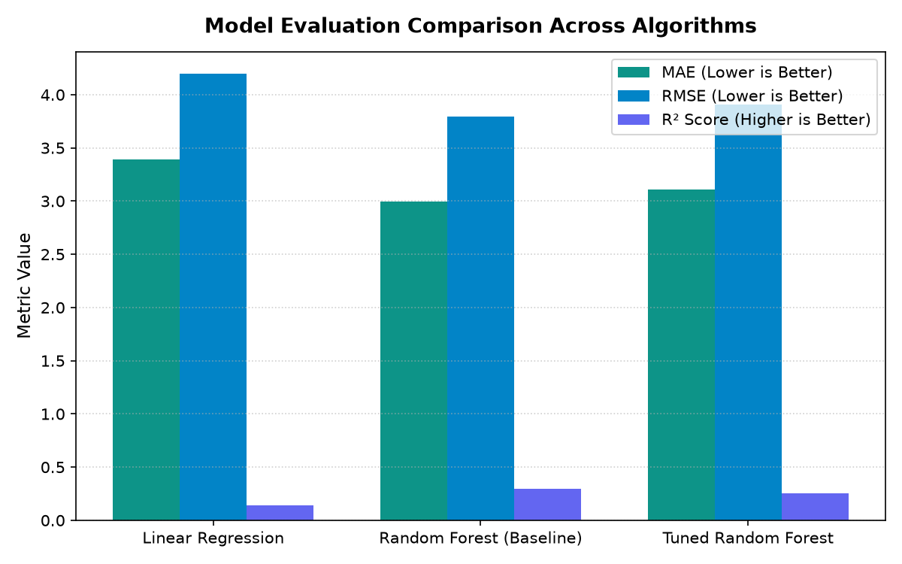
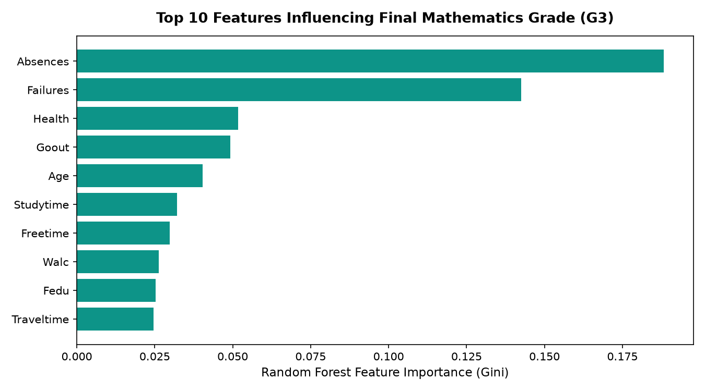
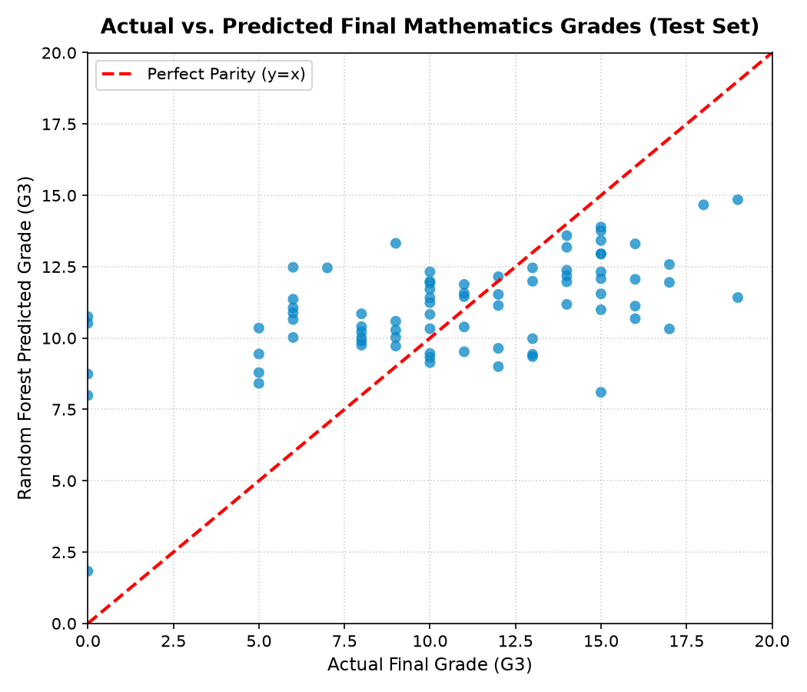
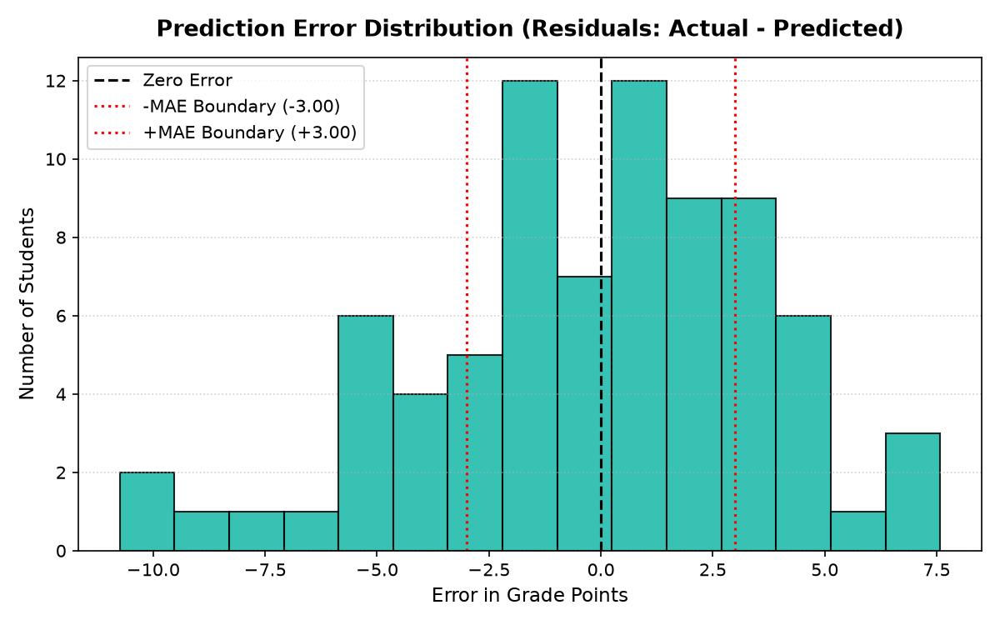

# 🎓 Student Performance Analytics & Grade Prediction System

[](https://www.python.org/)
[](https://streamlit.io/)
[](https://scikit-learn.org/)
[](https://plotly.com/)
[](LICENSE)

An academic machine learning system and interactive analytics dashboard designed to predict secondary school students' final mathematics examination grades ($G3 \in [0, 20]$) based on socio-demographic characteristics, academic background, parental education, study habits, and lifestyle factors.

---

## 📌 Table of Contents
- [Executive Overview](#-executive-overview)
- [Problem Statement](#-problem-statement)
- [Key Objectives](#-key-objectives)
- [Dataset Description & Attribution](#-dataset-description--attribution)
- [Deliberate Feature Selection Strategy](#-deliberate-feature-selection-strategy)
- [Machine Learning Architecture & Workflow](#-machine-learning-architecture--workflow)
- [Model Evaluation & Comparative Analysis](#-model-evaluation--comparative-analysis)
- [Key Findings & Feature Importance](#-key-findings--feature-importance)
- [Application Features & Screenshots](#-application-features--screenshots)
- [Project Directory Structure](#-project-directory-structure)
- [Local Installation & Execution Guide](#-local-installation--execution-guide)
- [Streamlit Cloud Deployment Guide](#-streamlit-cloud-deployment-guide)
- [Academic Limitations](#-academic-limitations)
- [Future Scope](#-future-scope)
- [Author & Acknowledgments](#-author--acknowledgments)

---

## 🔍 Executive Overview

Academic success in mathematics is shaped not only by classroom teaching but also by the complex interplay of social, environmental, and behavioral variables. In typical school environments, academic interventions often happen too late—after a student has already underperformed on midterm examinations ($G1$ or $G2$).

This project develops an **early-warning regression model** and an interactive **SaaS-styled analytics portal**. By intentionally excluding midterm exam grades, the system provides educators with predictive insights from the beginning of the academic semester, enabling proactive tutoring and mentorship.

---

## 🎯 Problem Statement

Traditional academic performance monitoring suffers from two fundamental limitations:
1. **Reactive Assessment**: Action is taken only after midterm tests are completed and grades have dropped.
2. **Siloed Evaluation**: Student evaluations often disregard lifestyle determinants such as commute duration, weekly study dedication, extracurricular commitments, and alcohol consumption habits.

**Challenge**: How accurately can an algorithm forecast a student's final year mathematics grade ($G3$, range 0–20) using strictly non-exam, demographic, and behavioral features available at enrollment?

---

## 🚀 Key Objectives

1. **End-to-End Pipeline**: Implement an automated machine learning workflow with `OneHotEncoder` and `RandomForestRegressor`.
2. **Prevent Target Leakage**: Deliberately exclude period grades $G1$ and $G2$ to build a genuine early-intervention instrument.
3. **Transparent Evaluation**: Benchmark algorithms using 5-Fold Cross-Validation, Mean Absolute Error (MAE), Root Mean Squared Error (RMSE), and $R^2$ Score.
4. **Interactive Web Application**: Provide educators and students with a clean, accessible Streamlit portal containing interactive Plotly charts, preset student profiles, and real-time inference.

---

## 📊 Dataset Description & Attribution

- **Source**: UCI Machine Learning Repository — Student Performance Data Set
- **Official URL**: [https://archive.ics.uci.edu/dataset/320/student+performance](https://archive.ics.uci.edu/dataset/320/student+performance)
- **Target Subject**: Mathematics Course (`student-mat.csv`)
- **Total Instances**: 395 secondary school students
- **Total Attributes**: 33 columns (30 input features, 2 period grades $G1, G2$, and 1 final grade $G3$)
- **Grading Scale**: Portuguese secondary education system:
  - **16 – 20**: Distinction / Very Good to Excellent (*Muito Bom / Excelente*)
  - **14 – 15**: Good (*Bom*)
  - **10 – 13**: Satisfactory / Passing (*Suficiente*)
  - **0 – 9**: Needs Improvement / Failing (*Insuficiente*)

### Input Features (30 Attributes)

| Category | Features | Description |
| :--- | :--- | :--- |
| **Personal Demographics** | `school`, `sex`, `age`, `address`, `famsize`, `Pstatus` | School attended, gender, age (15–22), urban/rural address, family size, cohabitation status |
| **Family Background** | `Medu`, `Fedu`, `Mjob`, `Fjob`, `reason`, `guardian` | Parental education levels (0–4), occupations, reason for school choice, legal guardian |
| **Study Habits & History** | `traveltime`, `studytime`, `failures`, `higher` | Commute time, weekly study hours (1–4), past class failures (0–3), aspiration for higher education |
| **Educational Support** | `schoolsup`, `famsup`, `paid`, `activities`, `nursery`, `internet` | School support, family support, extra paid classes, extracurriculars, nursery attendance, home internet |
| **Lifestyle & Health** | `famrel`, `freetime`, `goout`, `Dalc`, `Walc`, `health`, `romantic` | Family relationship quality, free time, going out, workday/weekend alcohol (1–5), health status, romantic relationship |
| **Attendance** | `absences` | Total number of school absence days (0–93) |

---

## 🧠 Deliberate Feature Selection Strategy

### Why Exclude G1 and G2?
Many baseline studies achieve high $R^2$ scores ($> 0.80$) simply by including $G1$ (first period) and $G2$ (second period) as inputs. However:
- **Operational Reality**: If $G1$ and $G2$ are already recorded, the academic year is over 70% finished.
- **Genuine Early Intervention**: Excluded $G1$ and $G2$ forces the machine learning model to find behavioral, social, and structural indicators of risk, enabling early intervention from the first week of classes.

---

## ⚙️ Machine Learning Architecture & Workflow

```
Raw CSV (395 Records)
       │
       ▼
Feature Selection (Drop G1, G2, G3) ──► 30 Features (X) & Target G3 (y)
       │
       ▼
Train/Test Split (80% Train: 316 / 20% Test: 79) [seed: 42]
       │
       ▼
Scikit-Learn ColumnTransformer Pipeline
 ├── 17 Categorical Features ──► OneHotEncoder(handle_unknown='ignore')
 └── 13 Numerical Features   ──► Passthrough
       │
       ▼
RandomForestRegressor (n_estimators=100, random_state=42)
       │
       ├──► 5-Fold Stratified Cross-Validation
       ├──► Hyperparameter Tuning via GridSearchCV
       └──► Model Serialization (`joblib.dump`)
```

---

## 📈 Model Evaluation & Comparative Analysis

The algorithms were evaluated on the held-out test split (79 unseen student records). The results below represent genuine experimental observations:

| Model Configuration | Mean Absolute Error (MAE) | Root Mean Squared Error (RMSE) | Test $R^2$ Score | Cross-Validation Mean $R^2$ |
| :--- | :---: | :---: | :---: | :---: |
| **Linear Regression Pipeline** | 3.395 | 4.196 | 0.142 | — |
| **Random Forest Regressor (Selected)** | **2.998** | **3.795** | **0.298** | **0.273 (5-fold)** |
| **Tuned Random Forest (GridSearchCV)** | 3.108 | 3.910 | 0.254 | 0.248 (3-fold) |

### Algorithmic Comparison Visual


### Key Observations:
1. **Random Forest Superiority**: Random Forest achieved lower error (MAE 2.998 vs. 3.395) and more than doubled the variance explained ($R^2$ 0.298 vs 0.142) compared to Linear Regression, capturing non-linear interactions among study time, past failures, and absences.
2. **Generalization Over Tuning**: The baseline Random Forest generalized better on the unseen test split than the hyperparameter-tuned model, which was slightly more conservative.

---

## 🔍 Key Findings & Feature Importance

### Top Influential Features


1. **School Absences (`absences`)**: The single strongest individual predictor. Excessive absences severely degrade predicted performance.
2. **Past Class Failures (`failures`)**: Prior academic struggle is a strong risk indicator.
3. **Mother's & Father's Education (`Medu`, `Fedu`)**: Higher parental educational attainment correlates with higher student achievement.
4. **Weekend Alcohol Consumption (`Walc`) & Socializing (`goout`)**: High weekend consumption and excessive outings negatively moderate final grade predictions.

### Test Set Residuals & Parity



- **Accuracy Band**: Over **43.0%** of test predictions are within $\pm 2$ grade points of actual final grades.
- **Error Distribution**: Symmetrically distributed around zero with a slight regression-to-the-mean tendency for extreme 0 and 20 scores.

---

## 💻 Application Features & Screenshots

- **🏠 Home & Overview**: Project orientation, dataset KPIs, core objectives, and methodology highlights.
- **🎯 Student Prediction Form**: 
  - Organized inputs into 6 intuitive card sections.
  - Interactive preset profile buttons: *High Achiever*, *Average Student*, *At-Risk Student*, and *Reset*.
  - Real-time Plotly visual gauge with color-coded performance tiers.
  - Diagnostic feedback identifying positive drivers and risk factors.
- **📊 Analytics Dashboard**:
  - Interactive Plotly actual-vs-predicted scatter plot with hover tooltips.
  - Interactive feature importance bar chart.
  - Error histogram with $\pm\text{MAE}$ boundary lines.
  - Grade tier error breakdown (0–5, 6–10, 11–15, 16–20).
- **📖 About Project**: Complete background documentation, mathematical formulation, and academic transparency notes.

---

## 📁 Project Directory Structure

```
student-performance-mini-project/
│
├── app.py                             # Main Streamlit web application
├── test_app.py                        # Automated validation & test suite
├── student_performance_random_forest.pkl # Serialized Random Forest ML pipeline
├── student_performance_model.pkl      # Serialized Linear Regression baseline
├── student-mat.csv                    # UCI Mathematics Dataset (395 records)
├── student_feature_importance.csv     # Extracted feature importance table
├── student_prediction_results.csv     # Test set predictions and residuals
├── student_performance_prediction_day01.py # Original research & experiment script
├── ALML.pdf                           # Academic syllabus & lab practical guidelines
├── requirements.txt                   # Production package dependencies
├── .gitignore                         # Git exclusion rules
├── README.md                          # Documentation & portfolio report
│
├── .streamlit/
│   ├── config.toml                    # Streamlit Navy/Teal theme configuration
│   └── credentials.toml               # Headless server credential settings
│
└── screenshots/
    ├── model_comparison.png           # Algorithmic benchmark comparison chart
    ├── feature_importance.png         # Top 10 Random Forest feature importances
    ├── actual_vs_predicted.png        # Test set actual vs predicted scatter plot
    └── error_distribution.png         # Test set prediction error histogram
```

---

## 🛠️ Local Installation & Execution Guide

### Prerequisites
- Python 3.9 to 3.13 installed
- Git installed

### 1. Clone the Repository
```bash
git clone https://github.com/Tejaswini-2006/student-performance-mini-project.git
cd student-performance-mini-project
```

### 2. Create and Activate a Virtual Environment
```bash
# Windows
python -m venv .venv
.venv\Scripts\activate

# macOS / Linux
python3 -m venv .venv
source .venv/bin/activate
```

### 3. Install Required Dependencies
```bash
pip install -r requirements.txt
```

### 4. Run the Automated Test Suite
```bash
python test_app.py
```

### 5. Launch the Streamlit Web Application
```bash
streamlit run app.py
```
Open your browser and navigate to `http://localhost:8501`.

---

## ☁️ Streamlit Cloud Deployment Guide

This repository is optimized for one-click deployment on [Streamlit Community Cloud](https://share.streamlit.io/):

1. Fork or push this repository to your GitHub account: `https://github.com/Tejaswini-2006/student-performance-mini-project`
2. Log in to [share.streamlit.io](https://share.streamlit.io/) with your GitHub account.
3. Click **"New app"**.
4. Select the repository: `Tejaswini-2006/student-performance-mini-project`.
5. Select branch: `main`.
6. Set the main file path: `app.py`.
7. Click **"Deploy!"**.

---

## ⚠️ Academic Limitations

1. **Variance Ceiling Without Midterms ($R^2 \approx 0.30$)**: Predicting human academic achievement without historical grades is inherently challenging; personality, teacher dynamics, test anxiety, and cognitive factors are not captured in the dataset.
2. **Grade 0 Anomaly**: In the Portuguese school system, students who drop out or fail to attend the exam receive a 0. Regression algorithms predict the mathematical conditional mean (~9.5), resulting in higher absolute residuals on dropout cases.
3. **Regional Specificity**: The dataset originates from two schools in Portugal; generalization to different education systems requires local calibration.

---

## 🔮 Future Scope

- **Two-Stage Hurdle Model**: Combine a binary classifier (predicting exam attendance / dropout: 0 vs. >0) with a regressor (predicting 1–20 marks for active examinees).
- **Multi-Course Transfer Learning**: Jointly train with the Portuguese language dataset (`student-por.csv`) using multi-task neural networks.
- **Explainable AI Integration**: Integrate SHAP (*SHapley Additive exPlanations*) to generate personalized student scorecards detailing individual positive and negative grade drivers.

---

## 👩‍💻 Author & Acknowledgments

- **Author**: Tejaswini Rakhunde
- **Course**: B.Tech / B.E. Information Technology (Third Year)
- **Internship / Subject**: Artificial Intelligence & Machine Learning (AI/ML)
- **Dataset Reference**: P. Cortez and A. Silva. *Using Data Mining to Predict Secondary School Student Performance*. In A. Brito and J. Teixeira (Eds.), Proceedings of 5th FUture BUsiness TEChnology Conference (FUBUTEC 2008) pp. 5-12, Porto, Portugal, April, 2008. EUROSIS, ISBN 978-9077381-39-7.

---
*Developed for academic mini-project demonstration and portfolio showcase.*
